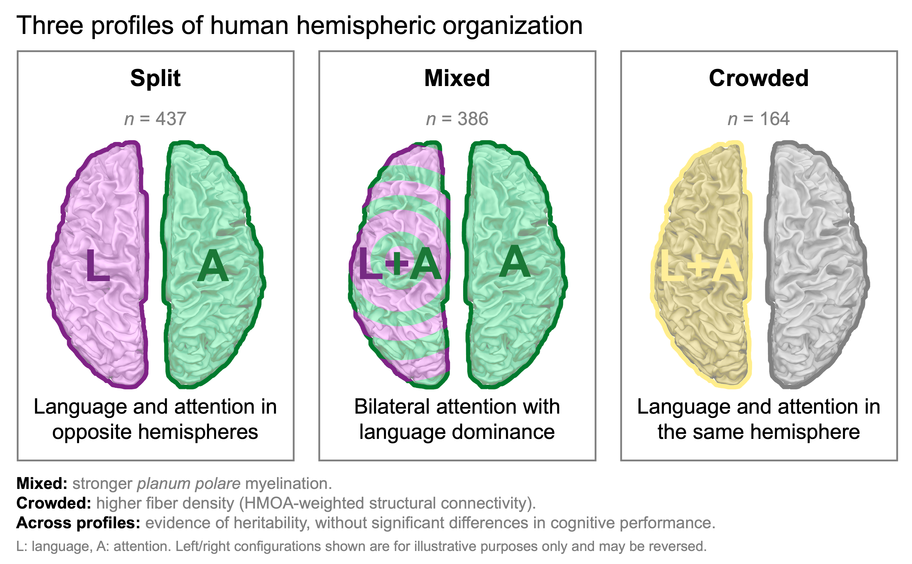

Hemispheric Complementarity is Associated with Distinct Functional and
Structural Brain Profiles
================

<!-- Add a Zenodo DOI badge here after archiving the first public release. -->

------------------------------------------------------------------------

## Contents

- [Background](#background)
- [Reference](#reference)
- [Code Release](#code-release)
- [Data](#data)
- [Atlas Used](#atlas-used)
- [Other related papers that might interest
  you](#other-related-papers-that-might-interest-you)
- [Questions](#questions)

------------------------------------------------------------------------

## Background

**Hemispheric specialization** is a fundamental feature of brain
organization, yet it remains unclear whether language and attention
consistently lateralize to opposite hemispheres. Using multimodal
neuroimaging and twin-family data from **987 Human Connectome Project
participants**, we characterized sustained-attention lateralization and
identified three phenotypes: **Typical**, **Bilateral**, and
**Atypical**. Combining attention with [language
lateralization](https://doi.org/10.1038/s41467-023-39131-y) revealed
three hemispheric configurations: **Split**, **Mixed**, and **Crowded**.
These profiles were associated with distinct functional and structural
properties: bilateral attention showed stronger intrinsic connectivity,
Mixed organization was linked to greater myelination in the left *planum
polare*, and Crowded organization to higher distributed fiber-density
connectivity. Both attention and cross-domain phenotypes showed evidence
of heritability, but the three configurations did not differ
significantly in cognitive performance. Together, these findings suggest
that hemispheric specialization reflects flexible, and heritable
patterns of brain organization.

------------------------------------------------------------------------

## Reference

For usage of the ***manuscript***, please cite:

- **Labache, L.**, Beyh, A., Cooper, R., Parkes, L., & Holmes, A. J.
  (2026). *Hemispheric Complementarity is Associated with Distinct
  Functional and Structural Brain Profiles*. bioRxiv (*preprint*). DOI:
  [10.64898/2026.10.09.758042](https://doi.org/10.64898/2026.10.09.758042).

<!-- 
For usage of the associated ***code***, please also cite:
&#10;- **Labache, L.**, Beyh, A., Cooper, R., Parkes, L., & Holmes, A. J. (2026). *Hemispheric Complementarity is Associated with Distinct Functional and Structural Brain Profiles*. `loiclabache/Labache_2026_HeCo`: [https://github.com/loiclabache/Labache_2026_HeCo](https://github.com/loiclabache/Labache_2026_HeCo). A permanent software DOI can be added here after a repository release has been archived.
-->

------------------------------------------------------------------------

## Code Release

The `Script` folder contains nine `R` scripts corresponding to the
analyses presented in the manuscript, and two additional scripts
containing shared functions. These scripts are designed to facilitate
the replication of the results detailed in the **Methods** section,
using the derived HCP datasets described below.

- `1_population_variation_attention.R`: `R` script to quantify the
  anatomical overlap between the language and attention atlases, and to
  classify participants according to ten functional markers derived from
  task and resting-state fMRI. Hierarchical clustering (Ward’s method)
  identifies the **Typical**, **Bilateral**, and **Atypical** attention
  phenotypes. The script also summarizes their distribution by
  self-reported sex and handedness.
- `2_task_evoked_asymmetry.R`: `R` script to examine differences in
  task-evoked attention asymmetry across attention phenotypes. The four
  measures correspond to the dorsal (*parieto-frontal*) and ventral
  (*temporo-frontal*) networks, assessed at both the network and hub
  levels. The script reports covariate-adjusted effects, estimated
  marginal means, and post-hoc comparisons.
- `3_intrinsic_connectivity.R`: `R` script to characterize resting-state
  functional connectivity across attention phenotypes. Six measures are
  examined: hemispheric strength asymmetry, bilateral network strength,
  and interhemispheric homotopic connectivity for the two attention
  networks.
- `4_sex_handedness.R`: `R` script to assess the association between
  attention phenotype membership, self-reported sex, and manual
  preference. Multinomial logistic regression is used to test main and
  interaction effects and to obtain adjusted phenotype probabilities.
- `5_hemispheric_complementarity.R`: `R` script to investigate the
  relationship between **attention and language lateralization**. A 3 ×
  3 contingency analysis tests their association, and a directional 2 ×
  2 analysis examines hemispheric complementarity among individuals with
  lateralized attention. The script also derives the three cross-domain
  configurations: **Split**, **Mixed**, and **Crowded**.
- `6_heritability.R`: `R` script to estimate the heritability of the
  attention and crowding phenotypes using HCP twin-family relationships.
  The analysis uses a kinship matrix, covariate adjustment, permutation
  testing, and a family-level jackknife standard error; it requires HCP
  **restricted family information**.
- `7_cognition.R`: `R` script to test associations between hemispheric
  organization and cognitive performance. The analysis considers ten
  cognitive outcomes, including fluid and crystallized cognition,
  episodic memory, cognitive flexibility, inhibition, processing speed,
  and working memory, with adjustment for demographic covariates.
- `8_myelin.R`: `R` script to examine cortical myelination across the
  **Split**, **Mixed**, and **Crowded** profiles. Vertex-wise myelin
  measures are first residualized for local cortical thickness and
  curvature. Random-field-theory-corrected surface analyses are followed
  by post-hoc comparisons of the identified cluster.
- `9_structural_connectivity.R`: `R` script to examine differences in
  structural connectivity across crowding phenotypes. Using matrices of
  median **hindrance-modulated orientational anisotropy (HMOA)** between
  400 cortical parcels, the script performs edge-wise models with
  false-discovery-rate correction and summarizes significant effects
  across the seven canonical functional networks.

The shared scripts are:

- `functions.R`: common functions for data loading, phenotype labeling,
  construction of the crowding variable, and statistical analyses.
- `h2_multi.R`: functions implementing the multivariate heritability
  estimator and family-level jackknife procedure used in
  `6_heritability.R`.

The code requires `R` (version 4.1 or later), as well as the packages
`dplyr`, `tidyr`, `NbClust`, `car`, `emmeans`, `purrr`, `tibble`,
`nnet`, `marginaleffects`, `solarius`, `progress`, `VertexWiseR`, and
`R.matlab`.

------------------------------------------------------------------------

## Data

All analyses are based on multimodal neuroimaging and behavioral data
from the **Human Connectome Project Young Adult** cohort
([HCP](https://www.humanconnectome.org/study/hcp-young-adult)). The main
sample includes *n* = 987 individuals with the task-based and
resting-state measurements necessary for attention phenotyping.

The `Data` folder documents the files required to reproduce the
analyses.

The primary inputs are:

- **Attention lateralization markers:**
  `HCP_987_participants_restMarkers_ALANs.csv` and
  `HCP_987_participants_taskMarkers_ALANs.csv`. Together, these datasets
  contain the ten functional characteristics of the dorsal and ventral
  attentional networks used to define attention phenotypes: four
  task-evoked asymmetry measures (network and hub) and six intrinsic
  functional-connectivity measures (strength asymmetry, strength sum,
  and homotopic connectivity). The measures are derived using the [ALANs
  atlas](https://github.com/loiclabache/ALANs_brainAtlas).
- **Attention and language phenotypes:** `HCP_987_participants.csv`
  contains the derived attention phenotype assignments, while
  `HCP_994_participants_Demographics_Cognition.csv` supplies the
  previously defined language phenotype and model covariates. Together,
  these files support the analyses of hemispheric complementarity. The
  combined phenotype and covariate table used in the subsequent analyses
  is `HCP_987_participants_phenotype_crowding.csv`.
- **Heritability and cognition:** `HCP_984_participants_FamilyData.csv`
  contains family-related information used for the kinship-based
  analyses and is **not publicly shared** because it is subject to **HCP
  Restricted Access** requirements. We are happy to provide the file
  upon request to researchers with the appropriate HCP Restricted Access
  authorization, where permitted by the applicable HCP data-use
  agreements. The cognitive measures used in this study originate from
  `HCP_1206_participants_unrestricted.csv` and can be obtained through
  the official HCP distribution.
- **Cortical myelination:**
  `HCP_987_participants_SmoothedMyelinMap.rds`,
  `HCP_987_participants_Curvature.rds`, and
  `HCP_987_participants_Thickness.rds` contain participant-level,
  vertex-wise surface imaging data used in the cortical myelination
  analyses. These files are **not publicly shared**. Access may be
  considered upon reasonable request from researchers with the
  appropriate HCP data-access authorization, subject to the applicable
  HCP data-use agreements and institutional requirements.
- **Structural connectivity:**
  `HCP_981_participants_400YanROIs_FiberDensity.Rds` contains individual
  400 × 400 parcel-level HMOA matrices used for the structural
  connectivity analysis.

**Important Note:** All original HCP participant IDs have been replaced
with anonymized identifiers throughout the data files. Information on
family structure and certain demographic variables is subject to HCP
restricted-access requirements and is therefore not shared in this
repository. Raw HCP data must be obtained through the official [HCP
access process](https://www.humanconnectome.org/study/hcp-young-adult);
only derived MRI metrics are publicly shared in this repository.
**Researchers with authorized HCP access are welcome to contact us. We
are happy to share the exact datasets used in this study, subject to the
applicable HCP data-use agreements.**

------------------------------------------------------------------------

## Atlases Used

The atlases used in this study are available through their respective
GitHub repositories and associated publications, as detailed below. The
`Atlas/` folder contains three description or parcel-to-network mapping
files used directly by the analysis scripts: `ALANs_description.txt`,
`SENSAAS_description.csv`, and `400Parcels_Yeo2011_7Networks.txt`.

- **ALANs (Atlas for Lateralized visuospatial Attentional Networks):**
  This atlas defines the **parieto-frontal (dorsal attention)** and
  **temporo-frontal (ventral attention)** networks examined in the
  study. Their regional and hub definitions were used to quantify
  task-evoked asymmetry, resting-state connectivity-strength asymmetry,
  bilateral network strength, and homotopic interhemispheric
  connectivity, which together characterize individual differences in
  attention lateralization. The network descriptions used in Script 1
  are provided in `Atlas/ALANs_description.txt`. The atlas and further
  documentation are available in the
  [ALANs_brainAtlas](https://github.com/loiclabache/ALANs_brainAtlas)
  GitHub repository and in the associated manuscript by [Labache and
  colleagues (2024)](https://doi.org/10.1162/imag_a_00208).

- **SENSAAS (SENtence Supramodal Areas AtlaS):** This atlas defines
  cortical regions supporting sentence (*language*) processing. Its
  **SENT_CORE** network was used to quantify the spatial overlap between
  language-related regions and the ALANs attention networks. In
  conjunction with previously established [language-lateralization
  phenotypes](https://github.com/loiclabache/Labache_2022_AO), the
  attention phenotypes were then used to define the **Split, Mixed, and
  Crowded** profiles of hemispheric organization. The language-network
  descriptions used in Script 1 are provided in
  `Atlas/SENSAAS_description.csv`. The atlas and further documentation
  are available in the
  [SENSAAS_brainAtlas](https://github.com/loiclabache/SENSAAS_brainAtlas)
  GitHub repository and in the associated manuscript by [Labache and
  colleagues (2019)](https://doi.org/10.1007/s00429-018-1810-2).

- **Yan 400-parcel homotopic parcellation and Yeo seven-network
  mapping:** The homotopic cortical parcellation of Yan and colleagues
  provides **400 corresponding cortical parcels across the two
  hemispheres**. This homotopic parcellation served as the common
  cortical framework for the parcel-based analyses conducted throughout
  this study. The **ALANs attention networks were projected onto this
  parcellation** to derive the task-evoked and resting-state attention
  lateralization markers used across the study. The same parcellation
  was also used to construct the **400 × 400 structural-connectivity
  matrices**. Parcels were additionally assigned to the **seven
  canonical functional networks** described by [Yeo and colleagues
  (2011)](https://doi.org/10.1152/jn.00338.2011). Script 9 uses
  `Atlas/400Parcels_Yeo2011_7Networks.txt` for these parcel-to-network
  assignments. The underlying Yan parcellation used in this study is
  available through its respective GitHub repositories [*version
  v0.28.3*](https://github.com/ThomasYeoLab/CBIG/tree/d4dd701cfaf18fcbad2367b918ca7ba6097871e0/stable_projects/brain_parcellation/Yan2023_homotopic).

------------------------------------------------------------------------

## Other related papers that might interest you

- **Atlas for the Lateralized Visuospatial Attention Networks (ALANs):**
  [Labache, L., et al. (2024)](https://doi.org/10.1162/imag_a_00208).
  Atlas and code:
  [ALANs_brainAtlas](https://github.com/loiclabache/ALANs_brainAtlas).
- **A SENtence Supramodal Areas AtlaS (SENSAAS):** [Labache, L., et
  al. (2019)](https://doi.org/10.1007/s00429-018-1810-2). Atlas and
  code:
  [SENSAAS_brainAtlas](https://github.com/loiclabache/SENSAAS_brainAtlas).
- **Typical and atypical language brain organization:** [Labache, L., et
  al. (2020)](https://doi.org/10.7554/eLife.58722).
- **Language network lateralization is reflected throughout the
  macroscale functional organization of cortex:** [Labache, L., et
  al. (2023)](https://doi.org/10.1038/s41467-023-39131-y). Code:
  [Labache_2022_AO](https://github.com/loiclabache/Labache_2022_AO).
- **Molecular and cellular correlates of human cortical
  lateralization:** [Labache, L., et
  al. (2026)](https://doi.org/10.1038/s42003-026-10508-1). Code:
  [Labache_2025_MolCelLat](https://github.com/loiclabache/Labache_2025_MolCelLat).

------------------------------------------------------------------------

## Questions

Please contact me (Loïc Labache) at <loic.labache@rutgers.edu>.
